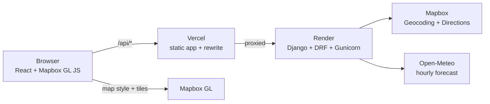

# Weather-Aware Truck Routing

A web app that helps a truck driver pick the safest of up to three routes by combining **weather forecasts at the time the truck actually reaches each point**, **load weight**, and **travel time**. Built with React + TypeScript on the front end and Django REST Framework on the back end.

- **Live application (React frontend):** https://truck-weather-assesment.vercel.app/
- **Backend API health check:** https://truckweather-assesment-production.up.railway.app/api/health
- **Source:** this repository

## Features

- Enter origin, destination, departure time, load weight and a checkpoint interval (10, 25 or 50 miles).
- Up to three route options, compared on distance, duration, arrival time, miles at each risk level and average risk.
- Weather sampled at every checkpoint, **using the truck's estimated arrival time there**, and classified with the assessment's risk and load rules.
- A recommended route with a plain-language explanation, plus warnings (for example, missing forecast data or No Travel conditions).
- Interactive map: all routes, the selected route colored by risk, checkpoint markers with ETA, wind gusts, rain, snow, risk level and the rule that triggered it.
- A 48-hour forecast heatmap along the selected route's corridor with an hour slider (no network requests while sliding).

## Architecture



The browser only talks to its own origin. In production, Vercel rewrites `/api/*` to the Render service, so no CORS configuration is needed. In development, Vite's dev proxy does the same.

```
backend/
  config/            Django settings and root URLs
  api/               thin views, request validation, JSON shaping
  services/
    risk.py          pure risk classification (wind, rain, snow, load rules)
    geometry.py      cumulative distance/time, interpolation, checkpoints and ETAs
    routing.py       Mapbox geocoding/directions, normalization, third-route search
    weather.py       Open-Meteo client: batching, ETA lookup, hourly forecast
    analysis.py      risk per checkpoint, miles per level, recommendation
    corridor.py      48-hour forecast risk along a route
  tests/             pytest, with mocked HTTP
frontend/
  src/api/           typed API client
  src/components/    trip form, route cards, map, forecast slider
  src/hooks/         forecast corridor loading and caching
  src/lib/           risk colors, formatting, popups
```

## How it works

### Risk rules

Each checkpoint is classified by wind, rain and snow separately, and the **highest** level wins.

| Condition | Low | Moderate | High | Severe | No Travel |
|---|---|---|---|---|---|
| Wind gusts | < 25 mph | 25 to < 35 | 35 to < 45 | 45 to < 55 | ≥ 55 mph |
| Rain | < 0.10 in/hr | 0.10 to < 0.25 | 0.25 to < 0.50 | 0.50 to 1.00 | > 1.00 |
| Snow | < 0.5 in/hr | 0.5 to < 1.0 | 1.0 to < 2.0 | 2.0 to 3.0 | > 3.0 |

Load rules (applied on top, using strict `>`):

- Wind ≥ 55 mph: **No Travel** for any load.
- Wind 45 to 54 mph and load > 30,000 lb: **No Travel**.
- Wind 35 to 44 mph and load > 40,000 lb: at least **Severe**.

Interpretation choices (the brief leaves these open):

- Wind is evaluated on **gusts** (`wind_gusts_10m`), a conservative choice for trucks. Sustained wind is shown for reference.
- Boundaries are half-open (25 mph is Moderate, 24.9 is Low). The "through" upper bounds for rain Severe (1.00) and snow Severe (3.0) are inclusive.
- Rain is `rain + showers` from Open-Meteo, in inches per hour.
- Exactly 30,000 lb or 40,000 lb does not trigger a load rule.

### Checkpoints, ETAs and weather

1. Checkpoints are placed every 10, 25 or 50 miles along the route, always including the origin and destination.
2. ETA at a checkpoint is the departure time plus the **cumulative per-segment duration** from the routing provider (not an average speed).
3. Open-Meteo is queried in batches for all checkpoints of all routes. Wind and gusts are linearly interpolated between hourly values; rain and snow use the hourly bucket containing the ETA (those values are hourly totals).
4. Each checkpoint represents half the distance to each neighbor, so **miles per risk level** and the distance-weighted **average risk** are computed over distance, not checkpoint counts.
5. Missing or out-of-range forecasts are **Unknown**, never Low. They are reported separately and counted as High when ranking, and the UI warns about them.

### Route recommendation

Routes are ranked lexicographically (lower is better):

1. Any No Travel conditions at all (a route with some is never recommended as safe; if every route has some, the app says so and suggests another departure time)
2. No Travel miles
3. Severe miles
4. High miles (including unknown)
5. Average risk
6. Travel time

Miles are compared to the nearest whole mile, average risk to 0.1, and time to the minute, so trivial differences do not outweigh real ones. The response includes a short explanation, for example how many Severe miles the recommended route avoids and what it costs in time.

### Route risk vs. the 48-hour forecast

These are two different things and the UI keeps them apart:

- **Route risk (ETA-based)** uses the forecast for each checkpoint *at the time the truck arrives there*. This is what the recommendation is based on.
- **48-hour forecast** is a *snapshot*: weather across the route corridor at an hour you pick on the slider, counted from the current hour. It does not depend on your departure time and **never changes the recommendation**.

For the forecast, the client sends the selected route's checkpoints (not its geometry). The server thins them to about one sample per 25 miles (at most 120), fetches 49 hourly values per sample in one batched request, and classifies each hour with the same risk engine and load rules. Switching routes fetches that route's forecast once and caches it; moving the slider only changes which hour the map layer reads.

### Getting three routes

Mapbox usually returns one or two routes. If fewer than three come back, the app makes up to two extra requests through a waypoint offset from the middle of the fastest route and keeps a result only if it shares less than 75% of its path with the others and takes at most 1.5 times the fastest duration. Routes are never duplicated or invented. If fewer than three are available, the app shows what exists and says why.

## API

**Backend base URL:** https://truck-weather-assesment.onrender.com

| Method and path | Purpose |
|---|---|
| `POST /api/analyze` | Routes, checkpoints, weather, risk, recommendation |
| `POST /api/forecast-corridor` | 48-hour forecast risk along a route |
| `GET /api/health` | Liveness check (no external calls) |

```json
POST /api/analyze
{
  "origin": "Chicago, IL",
  "destination": "Milwaukee, WI",
  "departure_time": "2026-11-27T09:00:00-06:00",
  "load_weight": 35000,
  "interval_miles": 25
}
```

Errors share one shape, `{"error": {"code", "message", "details"?}}`: `invalid_input` (400), `location_not_found` and `no_route` (422), `routing_unavailable` and `weather_unavailable` (502), `internal_error` (500). Messages never contain tokens or stack traces.

## Local setup

Prerequisites: Python 3.11+, Node 20.19+ (or 22.12+), a Mapbox account.

You need two Mapbox public tokens: one for the server (geocoding and directions) and a separate, URL-restricted one for the browser map (allow `http://localhost:5173`).

**Backend** (PowerShell):

```powershell
cd backend
python -m venv .venv
.\.venv\Scripts\Activate.ps1
pip install -r requirements.txt
copy .env.example .env      # then set MAPBOX_TOKEN in .env
python manage.py runserver
```

**Frontend** (second terminal):

```powershell
cd frontend
npm install
copy .env.example .env.local   # then set VITE_MAPBOX_TOKEN
npm run dev
```

Open http://localhost:5173. Vite proxies `/api` to Django on port 8000.

macOS/Linux: replace the activate line with `source .venv/bin/activate` and `copy` with `cp`.

## Tests

```powershell
cd backend
python -m pytest -q        # risk rules, geometry, routing, weather, analysis, API (HTTP is mocked)

cd ..\frontend
npm run build              # type-checks and builds
```

## Deployment

**Backend on Render** (Web Service)

- Root directory: `backend`
- Build command: `pip install -r requirements.txt`
- Start command: `gunicorn config.wsgi:application --bind 0.0.0.0:$PORT --workers 2 --threads 4 --timeout 120`
- Health check path: `/api/health`
- Environment: `PYTHON_VERSION=3.11.9`, `DJANGO_SECRET_KEY`, `DEBUG=0`, `MAPBOX_TOKEN`

**Frontend on Vercel**

- Root directory: `frontend` (Vite preset: build `npm run build`, output `dist`)
- Environment: `VITE_MAPBOX_TOKEN` (set before building)
- `frontend/vercel.json` rewrites `/api/*` to `https://truck-weather-assesment.onrender.com/api/*`.
- If using a URL-restricted browser token, allow `https://truck-weather-assesment.vercel.app/` in Mapbox. The Mapbox default public token is unrestricted.

No database migrations are needed: the API defines no models.

## Assumptions and limitations

- **US only.** Geocoding is restricted to the United States.
- **Not a truck-specific router.** Routes use Mapbox's general driving profile, so height, weight and hazmat restrictions are not considered. ETAs do not include live traffic or driver rest breaks.
- **Route count.** Mapbox often returns fewer than three routes; the third is a best-effort waypoint detour that may be omitted.
- **Forecast limits.** Open-Meteo provides about 16 days of hourly data at roughly kilometer-scale resolution; departures further out are rejected. Gusts are model values, not station observations.
- **Time zones.** The departure field uses your device's time zone, and times are displayed in it; it is not converted to the origin's local time.
- **Forecast corridor.** Samples lie on the route line (about one per 25 miles); the corridor width on the map is visual only.
- **Free hosting.** The Render free tier sleeps after inactivity, so the first request can take up to about a minute. The app pings `/api/health` on load to wake it.
- No authentication or rate limiting; this is a demonstration app.

## Possible next steps

Lateral sample points across the corridor, local-time display per checkpoint, truck-aware routing, forecast caching, and a play button for the slider.
